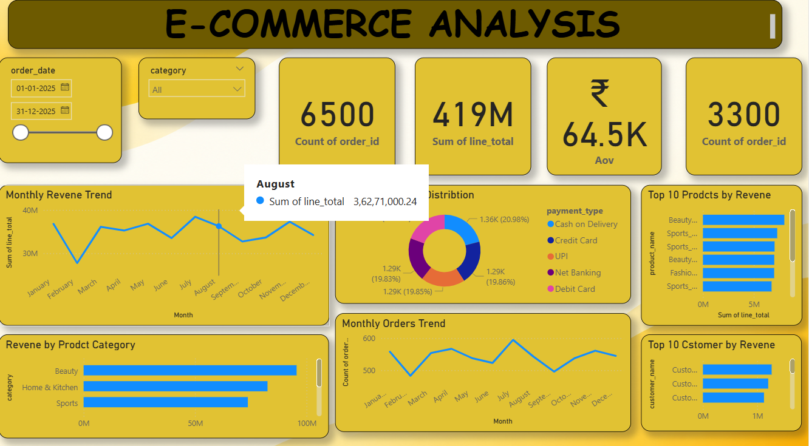

# E-commerce Sales Analytics

## Project Overview
This project analyzes e-commerce sales data using Python, SQL, and Power BI to identify sales trends, customer behavior, product performance, and payment preferences.

## Tools & Technologies
- **Python:** Pandas, data cleaning, exploratory data analysis (EDA), and visualization
- **SQL (MySQL):** Joins, CTEs, aggregations, and ranking functions
- **Power BI:** Interactive dashboard, KPI cards, charts, and slicers
- **Jupyter Notebook:** Python analysis environment

## Key Analysis
- Monthly sales and order trends
- Revenue by product category
- Top 10 products by revenue
- Top 10 customers by revenue
- Order status analysis
- Payment method distribution
- Average Order Value (AOV)

## Project Files
- `Untitled.ipynb` — Python analysis
- `Ecommerce_analysis.sql` — SQL queries
- `Ecommerce_Analytics.pbix` — Power BI dashboard

## Key Skills Demonstrated
Data cleaning, exploratory data analysis, SQL querying, data visualization, KPI reporting, and dashboard development.

## Power BI Dashboard Preview

## Author
Aryan Bansal
